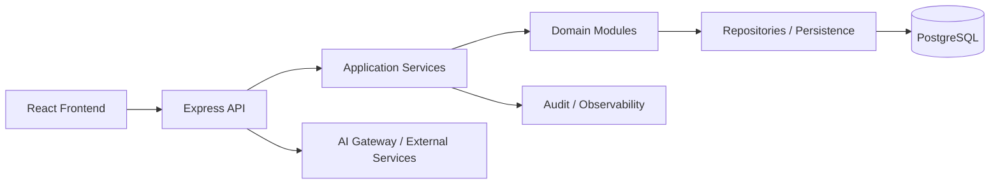
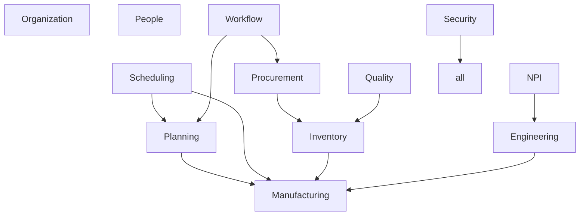

# ERP Architecture

## 1. Overview

This repository represents a manufacturing ERP proof-of-concept / working application built with a Vite React frontend and an Express TypeScript backend. The codebase already includes manufacturing, planning, inventory, procurement, quality, workflow, and AI capabilities. The architecture goal is to keep this as a modular monolith while improving domain boundaries, security, data persistence, and operational clarity.

## 2. System Context

The ERP operates around the following major flows:

- demand intake and planning
- BOM and routing management
- machine and manpower capacity validation
- production order generation and execution
- inventory movement and material reservations
- quality and work instruction execution
- procurement and supplier transactions
- governance, workflow approvals, and auditability
- AI-assisted document extraction and recommendations

The runtime architecture is conceptually:



## 3. Module Boundaries

The system should evolve toward explicit ownership for each domain:



## 4. Dependency Direction

Dependencies should flow inward toward the domain model and outward toward infrastructure. UI should depend on application services, not raw database logic. Domain modules should not import each other’s internal implementation state directly.

Recommended direction:

- Presentation -> Application -> Domain -> Infrastructure
- Policy and authorization live in the server-side application layer
- AI is an infrastructure capability, not a source of truth

## 5. Database Strategy

The target production database is PostgreSQL. The repository should evolve toward relational entities and repository-based access patterns. A relational schema is preferred over large JSON blobs or browser-based persistence for ERP source-of-truth data.

Key patterns:

- relational schema with foreign keys and constraints
- transaction boundaries around inventory and manufacturing actions
- repositories behind application services
- migration system for schema evolution
- indexes added based on actual query behavior
- server-side pagination and filtering for large tables

The current repository is still in a UI-first state in some places, but the architecture should treat the database as the ERP authority.

## 6. API Strategy

The backend exposes ERP endpoints for data access as well as orchestration endpoints for planning, scheduling, procurement, and governance workflows. API design should be consistent, explicit, and security-aware.

Rules:

- validate inputs on the server
- authenticate every sensitive request
- authorize using server-side identity and scope
- avoid trusting client-sent `role`, `userId`, or `organizationId` values
- use structured error handling and correlation IDs

## 7. Authentication and Authorization

Security must be implemented as architecture, not UI decoration. Authorization must be enforced server-side using a centralized model:

```text
USER
  ↓
ROLE
  ↓
PERMISSION
  ↓
ORGANIZATION / DATA SCOPE
  ↓
RESOURCE
```

The platform should follow the deny-by-default principle, least privilege, and centralized permission checks. UI checks are only a UX aid and not a security boundary.

## 8. RBAC and Data Scope

The ERP must support organization-aware data boundaries and user permissions. A user should be allowed to access only the resources and scope granted by the server-side security model.

This is especially important in manufacturing ERP workloads where users may work across plants, departments, or supplier/customer scopes.

## 9. Workflow Architecture

Workflow is reusable across approvals and governance processes. It should not be coupled only to planning.

Example workflow consumers:

- BOM approvals
- production plan approvals
- purchase request approvals
- engineering change reviews
- NPI decisions
- quality dispositions

The workflow system should distinguish between:

- workflow configuration
- workflow execution
- approval requests
- audit trail

## 10. Planning Architecture

Planning answers: "Can we produce this?"

Planning must consider:

- demand
- BOM explosion
- material requirements
- capacity constraints
- manpower capacity
- machine capacity
- cycle time and output rate
- feasibility and bottlenecks

Planning is not meant to be the finite scheduler. It should produce feasibility results and material/capacity implications, while scheduling determines the actual timing and machine assignment.

## 11. Scheduling Architecture

Scheduling answers: "When, where, and on which machine should production happen?"

Scheduling must account for:

- machine availability
- shifts and calendars
- manpower availability
- setup and changeover
- sequence constraints
- operation dependencies

Planning and scheduling remain separate responsibilities.

## 12. Inventory Architecture

Inventory should be transaction-oriented rather than a single `currentStock` field. Prefer transaction ledgers and derived balances.

Inventory transactions may include:

- receipt
- issue
- transfer
- adjustment
- production consumption
- production output
- reservation
- release
- scrap

Production, inventory, reservations, and audit records must remain consistent.

## 13. Manufacturing Architecture

Manufacturing logic is core ERP logic and must be reusable by planning and scheduling. The manufacturing module must model items, BOMs, routings, work centers, machines, tooling, and production orders with clear responsibilities.

Important design rule:

Cycle time is a first-class manufacturing parameter. Operations may include machine, work center, cycle time, setup time, manpower requirement, skill requirement, tooling requirement, and output rate.

## 14. NPI and Engineering Relationship

NPI and engineering change flows are adjacent to manufacturing but are not the same as day-to-day production execution. Engineering and NPI functions define design intent, approval states, and readiness checks, while production execution consumes that information.

## 15. AI Boundary

AI is an infrastructure/assistance layer and must remain distinct from deterministic ERP operations. It may support:

- document extraction
- recommendations
- summaries
- work instruction generation
- analysis and diagnostics

AI must not replace validated ERP business rules or production transactions.

## 16. Asynchronous Processing

Heavy planning and MRP-style work should be able to run asynchronously when workload justifies it. A queue/worker pattern is the preferred architectural pattern for large planning runs but must be introduced only when justified and kept behind explicit interfaces.

## 17. Audit Strategy

The ERP must support auditability for operational and governance transitions. Sensitive actions should be traceable, including:

- material movements
- production events
- workflow actions
- planning and scheduling changes
- security-related events

## 18. Observability

The system should include:

- correlation IDs / request IDs
- structured logs
- error tracking
- key performance metrics
- database query monitoring where practical
- background job health monitoring

No secrets, tokens, or passwords should be logged.

## 19. Scalability Strategy

The platform should be designed for large BOMs, production records, inventory transactions, audit entries, and workflow history. The architecture must avoid over-optimizing early, but it should plan for:

- server-side pagination and filtering
- efficient joins and indexes
- asynchronous heavy compute
- lazy loading or code splitting in the frontend
- large-table considerations without premature partitioning

## 20. Migration and Refactoring Strategy

The current repo has a working application but some parts are still UI-heavy and stateful. The migration strategy is incremental and safety-first.

1. establish contract and architecture documentation
2. preserve buildability and app integrity
3. separate domain/service responsibilities
4. move authoritative data to backend and repository abstractions
5. split large god-objects into coherent modules
6. refactor UI to consume application/service boundaries instead of raw domain logic
7. validate with build and targeted tests

## 21. Critical Guardrails

- Planning ≠ Scheduling
- Workflow ≠ Settings
- Employee ≠ User
- Inventory ≠ Current Stock Field
- UI State ≠ ERP Source of Truth
- AI ≠ Core Transaction Engine

This architecture contract is intended to guide implementation decisions and ensure the ERP remains coherent, auditable, and production-aware.
